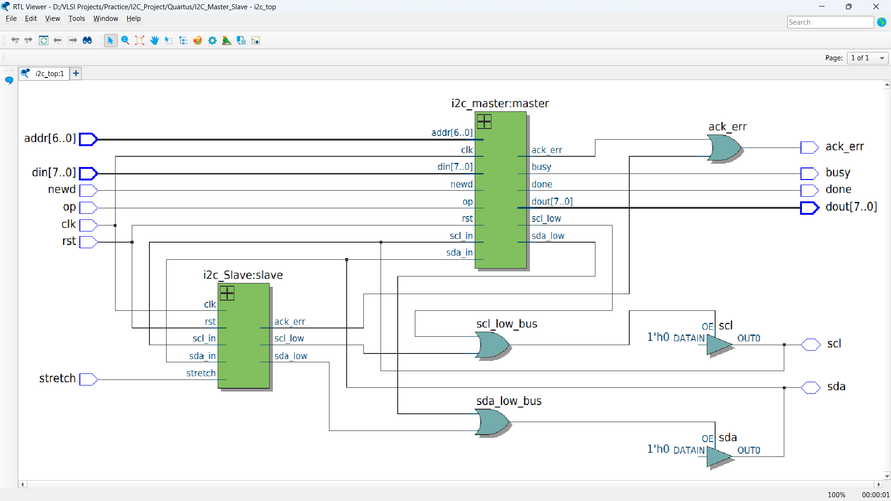
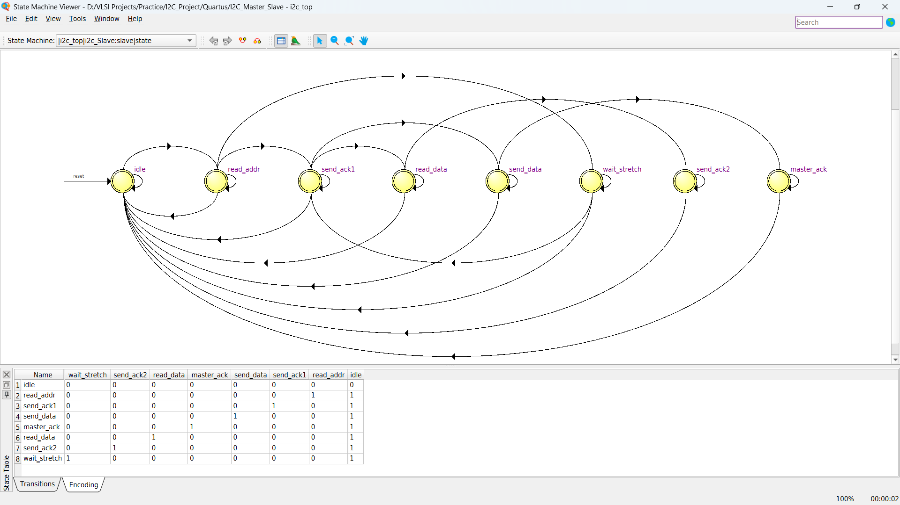

# I2C Master-Slave Controller | SystemVerilog

A SystemVerilog-based I²C Master-Slave RTL design supporting read and write transactions, clock stretching, 7-bit slave address matching, and ACK/NACK detection. The design is verified through ModelSim simulation and synthesized using Intel Quartus Prime.

## Overview

This project implements an I²C communication system consisting of an I²C Master and an I²C Slave connected through shared SDA and SCL lines.

The design supports:
- I²C master-to-slave write transactions.
- I²C slave-to-master read transactions.
- Clock stretching by the slave.
- 7-bit slave address matching.
- ACK and NACK detection.
- Open-drain SDA and SCL bus behavior.
- Read and write operations with and without clock stretching.

The slave uses a configurable 7-bit address, with the default address set to `7'd100` (`0x64`).

## Architecture

The design consists of three main RTL modules:

| Module | Description |
|---|---|
| `i2c_master` | Generates I²C transactions, sends addresses and data, and receives data and ACK/NACK responses. |
| `i2c_Slave` | Detects its address, handles read/write operations, provides ACK/NACK responses, and supports clock stretching. |
| `i2c_top` | Integrates the master and slave and manages the shared open-drain SDA and SCL bus connections. |

### Open-Drain Bus Implementation

The SDA and SCL lines use open-drain behavior. The master and slave can pull the bus low or release it. Pull-up behavior is modeled in the testbench using `tri1`.

The master and slave communicate their low-drive requests to the top-level module, which manages the shared bus.

## Clock Configuration

- FPGA input clock: 40 MHz
- Target I²C clock: 100 kHz
- Timing constraint: 25 ns clock period

## Verification

Functional verification was performed using ModelSim Intel FPGA Edition 2020.1.

The testbench covers the following scenarios:

| Test | Operation | Result |
|---|---|---|
| 1 | Write transaction without clock stretching | PASS |
| 2 | Write transaction with clock stretching | PASS |
| 3 | Read transaction without clock stretching | PASS |
| 4 | Read transaction with clock stretching | PASS |
| 5 | Incorrect slave address / NACK detection | PASS |

### Simulation Results

All five test scenarios passed.

The read transactions successfully returned the previously written data. The incorrect slave address was rejected, and the master detected the NACK condition.

## Synthesis and Implementation

The RTL design was synthesized using Intel Quartus Prime Lite 25.1.

**Compilation Summary:**

- Compilation status: Successful
- Errors: 0
- Warnings: 7
- Logic cells: 1,756
- Input pins: 20
- Output pins: 11
- Bidirectional pins: 2

### Timing Analysis

The design was analyzed using a 40 MHz input clock constraint.

| Timing Parameter | Worst Reported Slack |
|---|---:|
| Setup | +16.309 ns |
| Hold | +0.167 ns |
| Minimum Pulse Width | +11.586 ns |

The reported constrained clock paths have positive slack. External I/O timing paths have not been fully constrained with input and output delay requirements.

## Design Evidence

### RTL Viewer



### FSM Viewer



### Post-Mapping Netlist

The synthesized post-mapping netlist is available below:

[View Post-Mapping Netlist](netlist_post_mapping.pdf)

### Simulation Waveforms

Simulation waveform evidence is available in the [`simulation_waveform`](simulation_waveform/) directory.

## Tools Used

- SystemVerilog
- ModelSim Intel FPGA Edition 2020.1
- Intel Quartus Prime Lite 25.1
- FPGA target family: Intel Cyclone V

## Repository Structure

```text
I2C_Master_Slave/
│
├── rtl/                       # RTL source files
├── tb/                        # Testbench
├── quartus/                   # Quartus project and constraints
├── simulation_waveform/       # Simulation waveform evidence
│
├── RTL_view.png               # RTL architecture
├── FSM.png                    # FSM diagram
├── netlist_post_mapping.pdf   # Post-mapping netlist
├── .gitignore
├── LICENSE
└── README.md
```

## Hardware Validation

Functional verification and synthesis were performed using simulation and FPGA design tools. Physical FPGA hardware validation has not been performed.

## Learning Reference

This project was developed while learning and practicing concepts from the Udemy course:

**Communication Series P1: UART, SPI and I2C in Verilog**  
Instructor: Kumar Khandagle

The learning topics included:
- UART, SPI and I²C communication protocols.
- I²C Master and Slave operation.
- Read and write transactions.
- Clock stretching.
- Bit-banging concept and implementation approach.

The project was independently developed and extended with clock stretching, 7-bit slave address matching, ACK/NACK detection, and additional simulation test scenarios.

[View Course Completion Certificate](https://ude.my/UC-748d9afc-c82f-480a-a0a2-43a5defd373e)

## Author

**Rushikesh Dandgawhal**

GitHub: [Rushikesh-Dandgawhal](https://github.com/Rushikesh-Dandgawhal)

---

If you find this project useful, feel free to explore the RTL source code and simulation evidence.
